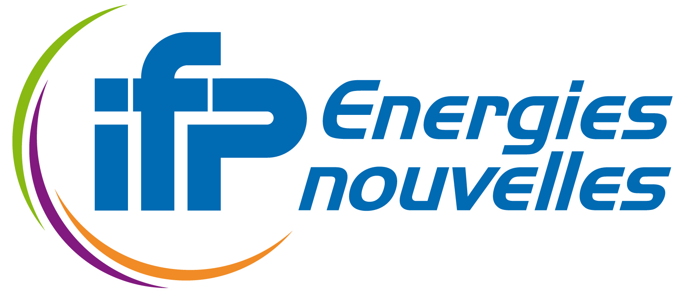

# MyIntrinsics++ (MIPP)

<p align="center">
  
</p>

<p align="center">
  <a href="https://github.com/aff3ct/MIPP/actions/workflows/ci.yml"></a>
  <a href="https://aff3ct.github.io/MIPP/"></a>
  <a href="LICENSE"></a>
  
  
</p>

<p align="center">
  
  
  
  
</p>

---

**MIPP** (*My Intrinsics Plus Plus*) is an open-source, header-only C and C++ SIMD wrapper library designed for cross-architecture data-parallel computing. It provides a portable, zero-overhead abstraction layer over hardware SIMD instruction sets, enabling developers to write high-performance vectorized algorithms once and compile them efficiently across **x86** (SSE, AVX, AVX-512), **ARM** (NEON, SVE), and **RISC-V** (RVV 1.0) targets.

**Documentation**: [https://aff3ct.github.io/MIPP/](https://aff3ct.github.io/MIPP/)

---

## Key Highlights

- **Tri-Dialect API Surface**: Write code in pure C99 (`<mipp.h>`), generic C++ Functional templates (`<mipp.hpp>`), or expressive C++ Objects with overloaded operators (`<mipp_obj.hpp>`).
- **100% Fallback Guarantee**: Every operation is guaranteed to compile and execute across all 10 supported data types through a deterministic 4-tier fallback engine (L0 Native Hardware &rarr; L1/L2 Emulation &rarr; L3 Scalar Loop).
- **Scalable & Next-Gen ISAs**: Native support for AVX-512, ARM SVE, and RISC-V Vector 1.0 with hardware register grouping (LMUL).
- **Zero Overhead & Header-Only**: Pure inlined assembly with zero runtime abstraction penalty. No build system dependencies, precompiled binaries, or external libraries required.

---

## Quick Example: Vectorized SAXPY

```cpp
#include <iostream>
#include <vector>
#include <mipp_obj.hpp>

// Computes y[i] = a * x[i] + y[i] across arbitrary sizes
void saxpy(float a, const float* x, float* y, size_t size)
{
    constexpr size_t N = mipp::Rvd<float>::N(); // Elements per SIMD register (e.g. 8 on AVX2)
    const size_t vec_limit = (size / N) * N;
    mipp::Rvd<float> va = a;

    // 1. Vector main loop
    for (size_t i = 0; i < vec_limit; i += N) {
        mipp::Rvd<float> vx(&x[i]);
        mipp::Rvd<float> vy(&y[i]);

        vy += va * vx; // Natural operators but SIMD instructions

        mipp::storeu(&y[i], vy);
    }

    // 2. Scalar tail loop for remaining elements
    for (size_t i = vec_limit; i < size; ++i) {
        y[i] += a * x[i];
    }
}

int main()
{
    const size_t size = 1007;
    std::vector<float> x(size, 2.0f);
    std::vector<float> y(size, 1.0f);

    saxpy(3.0f, x.data(), y.data(), size);

    std::cout << "y[0] = " << y[0] << " (expected: 7.0)" << std::endl;
    return 0;
}
```

Compile and run:
```bash
g++ -std=c++11 -O3 -mavx2 -mfma -Iinclude saxpy.cpp -o saxpy
./saxpy
```

---

## Quick Start & Integration

MIPP is header-only. Simply add the `include/` directory to your compiler's include path:

```bash
# Compilation examples:
g++ -std=c++11 -O3 -mavx2 -mfma -I/path/to/mipp/include app.cpp -o app          # x86 AVX2
g++ -std=c++11 -O3 -mavx512f -mavx512bw -I/path/to/mipp/include app.cpp -o app  # x86 AVX-512
g++ -std=c++11 -O3 -march=armv8-a+simd -I/path/to/mipp/include app.cpp -o app   # ARM NEON
```

For large codebases seeking minimum compilation times, MIPP also provides modular and atomic 2D headers (e.g. `<mipp/obj/fun/m/m2/add.hpp>`).

---

## Documentation

Comprehensive documentation, interactive tools, and developer guides are available online:

- **[Getting Started](https://aff3ct.github.io/MIPP/user/getting_started/)**: Installation, compilation flags, and complete loop vectorization patterns.
- **[Interactive API Explorer](https://aff3ct.github.io/MIPP/explorer/)**: Search across all 85+ vector primitives with reverse vendor intrinsic lookup (AVX, NEON, SVE, RVV).
- **[Programming Model](https://aff3ct.github.io/MIPP/user/programming_model/)**: Detailed reference for C99, C++ Functional, and C++ Object APIs, plus modular header organization.
- **[Comparison with Existing SIMD Solutions](https://aff3ct.github.io/MIPP/user/why_mippv2/#3-comparison-with-existing-simd-solutions)**: In-depth architectural comparison with Google Highway, xsimd, and Eve.
- **[Vector Types & LMUL](https://aff3ct.github.io/MIPP/user/vector_types_and_lmul/)**: Supported datatypes and register multiplier semantics.
- **[Masking Semantics](https://aff3ct.github.io/MIPP/user/masking_semantics/)**: Predication execution models (`unmasked`, `mask`, `maskz`, `masks`).
- **[Specifications & Hardware Matrices](https://aff3ct.github.io/MIPP/funcs_support/)**: Complete mathematical specifications and target architecture matrices.
- **[Developer Guide](https://aff3ct.github.io/MIPP/developper/)**: Code generation pipeline, JSON registries, and contributing guidelines.

---

## Institutional Support & Contributors

MIPP is developed and maintained through collaborative research and engineering efforts supported by academic and industrial institutions:

<table>
  <tr>
    <td align="center" width="33%" valign="middle">
      <a href="https://www.sorbonne-universite.fr/" target="_blank">
        <br/><br/>
        <b>Sorbonne Université</b>
      </a>
      <br/>
      <sub>LIP6 Laboratory / Faculty of Science and Engineering</sub>
    </td>
    <td align="center" width="33%" valign="middle">
      <a href="https://www.ifpenergiesnouvelles.fr/" target="_blank">
        <br/><br/>
        <b>IFP Energies nouvelles</b>
      </a>
      <br/>
      <sub>Energy, Transport & High-Performance Computing Research</sub>
    </td>
    <td align="center" width="33%" valign="middle">
      <a href="https://www.inria.fr/" target="_blank">
        <br/><br/>
        <b>Inria</b>
      </a>
      <br/>
      <sub>National Institute for Research in Digital Science and Technology</sub>
    </td>
  </tr>
</table>

---

## License

MIPP is released under the permissive [MIT License](LICENSE). It can be freely used, modified, and distributed in both open-source and proprietary commercial projects.
