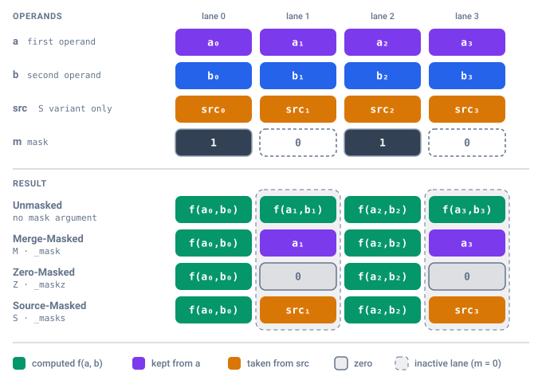

# Masking Semantics

MIPP provides first-class vector masking and predication across all supported architectures, unifying disparate hardware models under a single abstraction.

---

## 1. The Four Execution Variants

Every conditional vector operation in MIPP adheres to one of four standardized execution models. The figure shows a binary operation $f(a, b)$ on four lanes with the mask `1 0 1 0`: active lanes always receive $f(a, b)$, the variant decides what inactive lanes receive.

{ width="680" }

### 1.1. Semantics

For any binary operation $f(a, b)$ and mask vector $m \in \{0, 1\}^N$:

| Variant | C++ Variant | C API Suffix | Masking behavior |
| :--- | :--- | :--- | :--- |
| **Unmasked** | *(no mask argument)* | *(none)* | $\text{res}_i = f(a_i, b_i)$ |
| **Merge-Masked** | `M` | `_mask` | $\text{res}_i = \begin{cases} f(a_i, b_i) & \text{if } m_i = 1 \\ a_i & \text{if } m_i = 0 \end{cases}$ |
| **Zero-Masked** | `Z` | `_maskz` | $\text{res}_i = \begin{cases} f(a_i, b_i) & \text{if } m_i = 1 \\ 0 & \text{if } m_i = 0 \end{cases}$ |
| **Source-Masked** | `S` | `_masks` | $\text{res}_i = \begin{cases} f(a_i, b_i) & \text{if } m_i = 1 \\ \text{src}_i & \text{if } m_i = 0 \end{cases}$ |

An unmasked operation is a call without a mask: the `mipp::U` enumerator is not accepted by the masked signatures.

!!! note "Relation to AVX-512 terminology"
    The names borrow the AVX-512 terms, with one difference: an AVX-512 merge-masked intrinsic (`_mm512_mask_add_ps(src, k, a, b)`) takes the inactive lanes from an explicit `src`, which is MIPP's **Source-Masked** variant. MIPP's **Merge-Masked** variant merges into the first operand, i.e. the AVX-512 form with `src = a`.

!!! info "Per-Function Mask Support Matrix"
    Not every MIPP function supports all four masking variants across all datatypes and architectures. Exact mask variant availability for any specific function is documented in the auto-generated reference pages under `Function Support` (e.g. [`funcs_support/arithmetic/add.md`](../funcs_support/arithmetic/add.md)).

---

## 2. Syntax in Each API

### 2.1. C API (`<mipp.h>`)
Functions encode the variant directly in their name:

```c
// Mask generation via comparison:
rvm_float32_t m = mipp_cmplt_float32(va, vb);

// 1. Unmasked:
rvd_float32_t res_u = mipp_add_float32(va, vb);

// 2. Merge-Masked:
rvd_float32_t res_m = mipp_add_float32_mask(m, va, vb);

// 3. Zero-Masked:
rvd_float32_t res_z = mipp_add_float32_maskz(m, va, vb);

// 4. Source-Masked:
rvd_float32_t res_s = mipp_add_float32_masks(m, vsrc, va, vb);
```

### 2.2. C++ Functional API (`<mipp.hpp>`)
The mask variant is supplied as the first template argument (`<mipp::M>`, `<mipp::Z>`, `<mipp::S>`). Because `mipp::rvd<T, LMUL>` is a type alias to an internal type trait (`rvd_type<T, LMUL>::type`), C++ template argument deduction cannot deduce `T`. Therefore, `T` (and `LMUL` if different from `1`) must be explicitly specified:

```cpp
auto m = mipp::cmplt(va, vb);

// 1. Unmasked (deduced automatically from operand types):
auto res_u = mipp::add(va, vb);

// 2. Merge-Masked: preserves va on false
auto res_m = mipp::add<mipp::M, float, 1>(m, va, vb); // or mipp::add<mipp::M, float>(m, va, vb)

// 3. Zero-Masked: zeroes inactive elements on false
auto res_z = mipp::add<mipp::Z, float, 1>(m, va, vb);

// 4. Source-Masked: preserves values from vsrc on false
auto res_s = mipp::add<mipp::S, float, 1>(m, vsrc, va, vb);
```

!!! note "LMUL in C++ Functional API Calls"
    When $\text{LMUL}=1$, it can be omitted (`mipp::add<mipp::M, float>(m, va, vb)`). For multi-register operations ($\text{LMUL} > 1$), both `T` and `LMUL` must be specified explicitly (e.g. `mipp::add<mipp::M, float, 2>(m, va, vb)`).

### 2.3. C++ Object API (`<mipp_obj.hpp>`)

Because `mipp::Rvd<T, LMUL>` and `mipp::Rvm<T, LMUL>` are class templates rather than type aliases, the compiler automatically deduces both `T` and `LMUL` from the argument objects. Masked operations only require the variant template argument:

```cpp
mipp::Rvm<float> m = (va > vb); // Mask produced by comparison operator
mipp::Rvd<float> vsrc = 0.0f;

// 1. Unmasked:
auto res_u = mipp::add(va, vb);

// 2. Merge-Masked: preserves va on false
auto res_m = mipp::add<mipp::M>(m, va, vb);

// 3. Zero-Masked: zeroes inactive elements on false
auto res_z = mipp::add<mipp::Z>(m, va, vb);

// 4. Source-Masked: preserves values from vsrc on false
auto res_s = mipp::add<mipp::S>(m, vsrc, va, vb);
```

!!! tip "Concise Mask Syntax & Automatic Template Deduction"
    With `using mipp::M;` (or `Z`, `S`), you can write clean, expressive calls without repeating datatypes or namespaces:
    ```cpp
    using mipp::M;
    auto res = mipp::add<M>(m, va, vb);
    ```
    The element datatype `T` and the register multiplier `LMUL` are automatically deduced from the `Rvm` and `Rvd` operand objects.

---

## 3. Architectural Hardware Mappings

Different CPU architectures implement masking using fundamentally distinct mechanisms. MIPP classifies mask execution into native hardware predication and two distinct forms of emulation:

| Architecture | Mask Representation in MIPP | Execution Mechanism | Support Classification |
| :--- | :--- | :--- | :--- |
| **RISC-V Vector 1.0** | **Boolean Vectors (`vbool*`)**: Dedicated hardware mask vector registers. | Native instruction-level predication (`vadd.vv ..., v0.t`) with undisturbed inactive elements. | **Native (Hardware predication)** |
| **x86 AVX-512** | **Full-Vector Masks** *(Future: `__mmask*` opmasks)* | Currently evaluates unmasked op and blends result via software fallback. | **Emulated (MIPP implementation limitation)** |
| **ARM SVE** | **Full-Vector Masks** *(Future: `svbool_t` predicates)* | Currently evaluates unmasked op and blends result via software fallback. | **Emulated (MIPP implementation limitation)** |
| **x86 SSE / AVX / AVX2** | **Full-Vector Masks**: SIMD registers with all-1s (`0xFF...`) or all-0s per element. | Evaluates unmasked op followed by vector blend instructions (`_mm_blendv_ps`, `_mm256_blendv_ps`) or bitwise multiplexing. | **Emulated (Hardware limitation)** |
| **ARM NEON** | **Full-Vector Masks**: Vector registers with bitmasks per element (`uint32x4_t`, etc.). | Evaluates unmasked op followed by bitwise selection (`vbslq_f32`) or logical masking. | **Emulated (Hardware limitation)** |
| **Scalar Target** | **Unsigned Integer Arrays**: Sized to match datatype bitwidth (`uint64_t m[N]`, `uint32_t m[N]`, etc.). | Sequential ternary evaluation: `res[i] = m[i] ? (a[i] + b[i]) : src[i]`. | **Sequential Fallback** |

!!! note "Distinction Between Emulation Modes"
    - **Hardware Limitation (SSE, AVX, NEON)**: These instruction sets lack native instruction-level predication for general arithmetic. Emulating masked execution via vector blending (`blendv`, `vbslq`) is the only viable mechanism on these ISAs.
    - **MIPP Implementation Limitation (AVX-512, SVE)**: While AVX-512 and SVE feature dedicated hardware opmask/predicate registers, MIPPv2 currently routes them through full-vector mask emulation. Native `k`-register and `svbool_t` bindings will be added in upcoming generator revisions.

---

## 4. Mask Generation & Relational Comparisons

Masks are generated by element-wise comparison primitives returning an `rvm` type:

| Operation | C API Function | C++ Functional API | Semantics |
| :--- | :--- | :--- | :--- |
| **Equal** | `mipp_cmpeq_[type]_[lmul]` | `mipp::cmpeq(a, b)` | $m_i = (a_i == b_i)$ |
| **Not Equal** | `mipp_cmpneq_[type]_[lmul]` | `mipp::cmpneq(a, b)` | $m_i = (a_i \neq b_i)$ |
| **Less Than** | `mipp_cmplt_[type]_[lmul]` | `mipp::cmplt(a, b)` | $m_i = (a_i < b_i)$ |
| **Less or Equal** | `mipp_cmple_[type]_[lmul]` | `mipp::cmple(a, b)` | $m_i = (a_i \le b_i)$ |
| **Greater Than** | `mipp_cmpgt_[type]_[lmul]` | `mipp::cmpgt(a, b)` | $m_i = (a_i > b_i)$ |
| **Greater or Equal** | `mipp_cmpge_[type]_[lmul]` | `mipp::cmpge(a, b)` | $m_i = (a_i \ge b_i)$ |

---

## 5. Mask Boolean Algebra

Masks can be combined, inverted, and manipulated using boolean logical operations. In the C++ Functional API:

```cpp
// C++ Functional API
auto m1 = mipp::cmplt(va, vb);
auto m2 = mipp::cmpgt(va, vc);

// Logical AND (m1 AND m2):
auto m_and = mipp::andb(m1, m2);

// Logical OR (m1 OR m2):
auto m_or  = mipp::orb(m1, m2);

// Logical XOR (m1 XOR m2):
auto m_xor = mipp::xorb(m1, m2);

// Logical NOT (~m1):
auto m_not = mipp::notb(m1);

// Logical AND-NOT ((NOT m1) AND m2):
auto m_andn = mipp::andnb(m1, m2);
```

- **C API**: the same functions with the `_k` suffix, which marks the mask overloads: `mipp_andb_k_float32(m1, m2)`, `mipp_orb_k_float32`, `mipp_xorb_k_float32`, `mipp_notb_k_float32(m1)`, `mipp_andnb_k_float32`.
- **C++ Object API**: the operators `m1 & m2`, `m1 | m2`, `m1 ^ m2`, `~m1` (or `!m1`) on `Rvm` objects, plus the free function `mipp::andnb(m1, m2)`, which has no operator (see [Programming Model](programming_model.md#42-overloaded-operators-reference)).

---

## 6. Mask Conversion & Reinterpretation

MIPP provides explicit primitives to convert between vector registers (`rvd`), mask registers (`rvm`), and scalar representations:

### 6.1. Strong Mask Typing & `cast_k` (Mask-to-Mask Conversion)
In MIPP, mask types are **strictly and strongly typed** to their corresponding numeric datatype $T$. For example, an `rvm<float>` produced by comparing floating-point vectors cannot be implicitly passed to an integer operation expecting an `rvm<int32_t>`, despite sharing the same 32-bit element size and element capacity.

To convert between mask types, MIPP provides explicit mask casting primitives (`cast_k` in C, `cast_[type]` in C++):

```c
// C API: explicit from_to function identifier with _k suffix
rvm_float32_t m_float = mipp_cmplt_float32(va, vb);
rvm_int32_t   m_int   = mipp_cast_k_float32_int32(m_float);
```

```cpp
// C++ Functional API: target type suffix (overloaded on rvm and rvd)
mipp::rvm<float> m_float = mipp::cmplt(va, vb);
mipp::rvm<int32_t> m_int = mipp::cast_int32(m_float);
```

```cpp
// C++ Object API: target type as template argument (overloaded on Rvm and Rvd)
mipp::Rvm<float> m_float = (oa < ob);
mipp::Rvm<int32_t> m_int = mipp::cast<int32_t>(m_float);
```

#### Semantics
`cast_k` / `cast_[type]` is **strictly an in-register bit reinterpretation** (e.g., `_mm256_castps_si256`, `__riscv_vreinterpret`, or direct struct assignment) between mask types of matching element bitwidths (e.g. `float32` $\leftrightarrow$ `int32` $\leftrightarrow$ `uint32`, or `float64` $\leftrightarrow$ `int64` $\leftrightarrow$ `uint64`). For data vectors, see [Type Conversions](vector_types_and_lmul.md#5-type-conversions) (`cast`, `cvt`, `wcvt`).

### 6.2. `tomsk` (Data Vector to Mask)
Converts a data vector `rvd<T>` into a mask register `rvm<T>` of the matching type $T$:

```cpp
// C API:
rvd_float32_t raw_vector = mipp_load_float32(ptr);
rvm_float32_t m = mipp_tomsk_float32(raw_vector);

// C++ API:
mipp::rvd<float> raw_vector = mipp::load<float>(ptr);
mipp::rvm<float> m = mipp::tomsk(raw_vector);
```

A lane is **active if its element has at least one bit set**, inactive if all its bits are zero. The test is on the bit pattern, not on the value: `-0.0` (sign bit set) and NaN give an active lane, `+0.0` an inactive one. Any input is valid, and the result is always a well-formed mask (on targets that store masks in vector registers, each active lane has all its bits set), so `tomsk(toreg(m))` returns `m` and the mask algebra of [§5](#5-mask-boolean-algebra) applies to the result. The behavior is the same on every target.

The converse does not hold in general: `toreg(tomsk(r))` returns `r` only if each lane of `r` is already `0` or has all its bits set. Any other non-zero lane becomes "all bits set": `1.0f` gives a NaN pattern, the integer `1` gives `-1`.

### 6.3. `toreg` (Mask to Data Vector)
Reinterprets/converts a mask handle `rvm<T>` into a full data vector `rvd<T>` of the matching type $T$ (where active lanes contain all-ones and inactive lanes contain `0`):

```cpp
// C API:
rvm_float32_t m = mipp_cmpeq_float32(va, vb);
rvd_float32_t mask_vector = mipp_toreg_float32(m);

// C++ API:
mipp::rvm<float> m = mipp::cmpeq(va, vb);
mipp::rvd<float> mask_vector = mipp::toreg(m);
```

### 6.4. `blend` (Conditional Element Multiplexing)
Selects elements between two data vectors according to a mask ($r_0$ when $m_i = 1$, $r_1$ when $m_i = 0$):

$$\text{res}_i = \begin{cases} r0_i & \text{if } m_i = 1 \\ r1_i & \text{if } m_i = 0 \end{cases}$$

The mask `m` is passed as the **first argument**:

```c
// C API: (mask, if_true, if_false)
rvd_float32_t chosen = mipp_blend_float32(m, if_true, if_false);
```

```cpp
// C++ Functional API: (mask, if_true, if_false)
auto chosen_fun = mipp::blend(m, if_true, if_false);

// C++ Object API: (mask, if_true, if_false)
auto chosen_obj = mipp::blend(m, if_true, if_false);
```

---

## 7. Mask Initialization (`set_k`, `set1_k`, `set0_k`)

MIPP provides functions to construct and initialize mask registers from scalar values. 

### 7.1. Function Signatures & Semantics

| Function | C API Function | C++ Functional API |  Semantics |
| :--- | :--- | :--- | :--- |
| **Array Init** | `mipp_set_k_[type]_[lmul](vals)` | `mipp::set_k<T, LMUL>(vals)` | Sets element $i$ active if `vals[i] != 0`, inactive if `vals[i] == 0`. |
| **Broadcast** | `mipp_set1_k_[type]_[lmul](val)` | `mipp::set1_k<T, LMUL>(val)` | Broadcasts truthiness: all elements active if `val != 0`, else inactive. |
| **Zero Init** | `mipp_set0_k_[type]_[lmul]()` | `mipp::set0_k<T, LMUL>()`  | Clears all elements (all inactive). |

### 7.2. Important Semantics & Particularities

1. **Fixed `int32_t` Input Array Type**:
    - Regardless of the underlying vector datatype `T` (whether `float64`, `int8`, `uint16`, etc.), `set_k` **always expects an array of `int32_t`**:
     ```c
     // In C: array of int32_t matching capacity N
     const int32_t mask_values[8] = {1, 0, 1, 0, 1, 1, 0, 0};
     rvm_float32_t m = mipp_set_k_float32(mask_values);
     ```
2. **C Truthiness Evaluation**:
    - `set_k` evaluates the *truthiness* of each integer element rather than copying raw bit patterns. Any non-zero integer (`vals[i] != 0`) sets the corresponding mask element to **active** (a boolean mask lane on RVV, an all-ones `~0` element on full-vector mask backends). A zero integer (`vals[i] == 0`) sets the element to **inactive** (`0`).
3. **The `_k` Suffix**:
    - The `_k` naming convention reflects AVX-512 opmask / predicate register naming (`k1..k7`), distinguishing mask factory functions (`set_k`, `set1_k`, `set0_k`) from numeric vector factories (`set`, `set1`, `set0`).

---

## 8. Masking & Multi-Register LMUL Interoperability

Masking and the Length Multiplier ($\text{LMUL}$) are orthogonal and fully composable across all MIPP interfaces. Predicated operations execute on multi-register vectors ($\text{LMUL} \in \{2, 4, 8\}$) and, on targets that provide them (AVX, AVX-512, RVV, scalar), on half-vectors (`d2` suffix in C, $\text{LMUL} = -2$ in C++).

### 8.1. Type Matching & Capacity
A comparison evaluated on an $\text{LMUL}=k$ data vector produces an $\text{LMUL}=k$ mask containing the exact matching element capacity:

$$\text{Capacity}(rvm\langle T, \text{LMUL} \rangle) = \text{Capacity}(rvd\langle T, \text{LMUL} \rangle) = N(T, \text{LMUL})$$

```c
// C API: explicit multiplied types and identifiers
rvd_float32_m2_t va = mipp_load_float32_m2(ptr_a);
rvd_float32_m2_t vb = mipp_load_float32_m2(ptr_b);

rvm_float32_m2_t m   = mipp_cmplt_float32_m2(va, vb);
rvd_float32_m2_t res = mipp_add_float32_mask_m2(m, va, vb);
```

```cpp
// C++ Functional API: explicit LMUL parameter required
auto va = mipp::load<float, 2>(ptr_a);              // mipp::rvd<float, 2>
auto vb = mipp::load<float, 2>(ptr_b);              // mipp::rvd<float, 2>
auto m  = mipp::cmplt(va, vb);                      // mipp::rvm<float, 2>
auto res = mipp::add<mipp::M, float, 2>(m, va, vb); // mipp::rvd<float, 2>

// C++ Object API: automatic LMUL and type deduction
mipp::Rvd<float, 2> oa(ptr_a);
mipp::Rvd<float, 2> ob(ptr_b);
auto om = (oa < ob);                                // mipp::Rvm<float, 2>
auto ores = mipp::add<mipp::M>(om, oa, ob);         // Deduces T=float and LMUL=2
```

### 8.2. Hardware Execution on Multi-Register Vectors

- **RISC-V Vector (RVV)**: Operates directly on hardware grouped registers (`vfloat32m2_t`) governed by the corresponding fractional boolean mask register (`vbool16_t` / `vbool8_t`).
- **Fixed-Width Architectures (x86, ARM)**: Multi-register masks (`rvm_*_m2_t`) and data vectors (`rvd_*_m2_t`) use recursive binary struct composition (`{ m1, m2 }` and `{ r1, r2 }`). The masked operation is applied independently to each register of the group (using the emulation strategy described in [Section 3](#3-architectural-hardware-mappings)), with no abstraction overhead once inlined.
