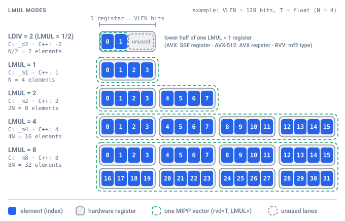

# Vector Types & Generalized LMUL

MIPP provides a unified vector type system supporting 10 standard numeric datatypes across configurable register multipliers ($\text{LMUL}$).

---

## 1. Supported Datatypes Matrix

MIPP standardizes naming across C and C++ interfaces:

--8<-- "docs/includes/generated/datatypes.md"

---

## 2. Vector Type Representation

### 2.1. Vector Handles
- **Value Registers**: `mipp::rvd<T, LMUL>` (underlying C struct / hardware handle) and `mipp::Rvd<T, LMUL>` (C++ class).
- **Mask Registers**: `mipp::rvm<T, LMUL>` and `mipp::Rvm<T, LMUL>`.

### 2.2. Compile-Time Element Capacity (`N`)
The total number of elements contained in a vector is retrieved via `mipp::N<T, LMUL>()` (C API: `MIPP_N_[TYPE]_[LMUL]` macros; C++ Object API: `mipp::Rvd<T, LMUL>::N()`):

$$N(T, \text{LMUL}) = \left( \frac{\text{VectorBitWidth}}{\text{sizeof}(T) \times 8} \right) \times \text{LMUL}$$

=== "C API"

    ```c
    --8<-- "examples/doc/vector_types_and_lmul/c.c:capacity"
    ```

=== "C++ Functional API"

    ```cpp
    --8<-- "examples/doc/vector_types_and_lmul/fun.cpp:capacity"
    ```

=== "C++ Object API"

    ```cpp
    --8<-- "examples/doc/vector_types_and_lmul/obj.cpp:capacity"
    ```

---

## 3. Generalized LMUL (Length Multiplier) Semantics

The Length Multiplier ($\text{LMUL} \in \{1, 2, 4, 8\}$) originates from **RISC-V Vector 1.0 (RVV)**, where hardware registers are grouped to scale vector capacity. To support RVV natively while maintaining an identical API across all backends, MIPP generalizes the LMUL concept across all supported ISAs.

On fixed-width architectures (x86, ARM), software LMUL functions as a **structured multi-register unrolling mechanism**: operations on $\text{LMUL}=2$ or $\text{LMUL}=4$ expand into discrete SIMD instructions across separate registers, increasing instruction-level parallelism (ILP) without manual loop unrolling, while developer discretion is required to manage register pressure at high LMUL values.

The figure also shows the [half-vectors](#half-vectors) ($\text{LDIV}=2$, i.e. $\text{LMUL}=1/2$), described in section 4.

{ width="680" }

!!! tip "Optimization Practice: Parameterizing Kernels by LMUL"
    When developing compute kernels in C++, parameterizing functions by `int LMUL = 1` makes it simple to explore the unrolling optimization space:
    
    ```cpp
    --8<-- "examples/doc/vector_types_and_lmul/fun.cpp:kernel"
    ```
    
    - **`LMUL=2` or `LMUL=4`** typically can yield performance gains in compute-bound loops by saturating execution units and interleaving instruction latencies.
    - **`LMUL=8`** often exhibits diminishing returns or regressions due to register spilling.

### 3.1. Hardware LMUL (RISC-V Vector 1.0)
On architectures with native register grouping support (RVV `v` extension), MIPP maps directly to hardware types:

- $\text{LMUL}=1$: `vfloat32m1_t`
- $\text{LMUL}=2$: `vfloat32m2_t` (2 adjacent hardware registers)
- $\text{LMUL}=4$: `vfloat32m4_t` (4 adjacent hardware registers)
- $\text{LMUL}=8$: `vfloat32m8_t` (8 adjacent hardware registers)

The vector execution unit operates on grouped registers as single wide units in hardware.

### 3.2. Software Recursive Binary Structs (x86, ARM)
On fixed-width SIMD architectures (SSE, AVX, AVX-512, NEON, SVE), MIPP emulates LMUL in software via **hierarchical binary structures**:

<!-- not-compiled: example of generated code (include/mipp/internal/), not user code -->

```c
/* Base Level: LMUL = 1 (Single hardware vector) */
typedef struct { __m256 r; } rvd_avx_float32_m1_t;

/* Multiplied Level: LMUL = 2 (Pair of LMUL=1 structs) */
typedef struct { rvd_avx_float32_m1_t r1, r2; } rvd_avx_float32_m2_t;

/* Multiplied Level: LMUL = 4 (Pair of LMUL=2 structs) */
typedef struct { rvd_avx_float32_m2_t r1, r2; } rvd_avx_float32_m4_t;

/* Multiplied Level: LMUL = 8 (Pair of LMUL=4 structs) */
typedef struct { rvd_avx_float32_m4_t r1, r2; } rvd_avx_float32_m8_t;
```

#### Compilation & Zero-Overhead Execution
When calling an operation on a multiplied vector (e.g., `mipp::add(va, vb)` on `LMUL=2`), the generator emits code evaluating the sub-components recursively:

<!-- not-compiled: example of generated code (include/mipp/internal/), not user code -->

```c
static inline rvd_avx_float32_m2_t mipp_avx_add_float32_m2(
    const rvd_avx_float32_m2_t r0,
    const rvd_avx_float32_m2_t r1)
{
    rvd_avx_float32_m2_t res;
    res.r1 = mipp_avx_add_float32_m1(r0.r1, r1.r1); // _mm256_add_ps
    res.r2 = mipp_avx_add_float32_m1(r0.r2, r1.r2); // _mm256_add_ps
    return res;
}
```

The compiler places `r1` and `r2` into separate CPU vector registers (e.g., `%ymm0` and `%ymm1`), inlining the calls into dual-issue instructions without memory round-trips.

### 3.3. Flattened Array Representation (Scalar Target)
In the scalar fallback backend, multi-register vectors are represented as flat arrays sized by the total capacity:

<!-- not-compiled: example of generated code (include/mipp/internal/), not user code -->

```c
typedef struct { float32_t r[MIPP_SCALAR_N_FLOAT32_M1]; } rvd_scalar_float32_m1_t;
typedef struct { float32_t r[MIPP_SCALAR_N_FLOAT32_M2]; } rvd_scalar_float32_m2_t;
typedef struct { float32_t r[MIPP_SCALAR_N_FLOAT32_M4]; } rvd_scalar_float32_m4_t;
typedef struct { float32_t r[MIPP_SCALAR_N_FLOAT32_M8]; } rvd_scalar_float32_m8_t;
```

Scalar operations execute flat sequential loops over all $N \times \text{LMUL}$ elements.

### 3.4. Representation per Target

The table gives, for each target, the representation of each LMUL and of the [half-vectors](#half-vectors). It is generated from the ISA descriptors of the generator (`sw_lmul`, `hw_lmul`).

--8<-- "docs/includes/generated/lmul_availability.md"

---


<a id="half-vectors"></a>
## 4. Half-Vectors (`d2`)

In addition to multi-register expansion ($\text{LMUL} > 1$), MIPP provides **half-vectors**: vectors holding half the elements of a base register. The same concept appears under several notations, which all mean the same thing:

| Context | Notation |
| :--- | :--- |
| Concept | half-vector, length divider $\text{LDIV} = 2$ (equivalently $\text{LMUL} = 1/2$) |
| C API types and functions | `d2` suffix: `rvd_float32_d2_t`, `mipp_add_float32_d2` |
| C++ Functional and Object APIs | `LMUL` template argument `-2`: `mipp::rvd<float, -2>`, `mipp::Rvd<float, -2>` |
| Availability macro | `MIPP_LDIV_2` |
| Generator (`sw_lmul`, `hw_lmul`, `--ldiv`) | factor `-2`, or `--ldiv 2` |

The same loop in the three APIs (half-vectors are not available on every target, hence the `MIPP_LDIV_2` guard, see [§4.1](#41-availability)):

=== "C API"

    ```c
    --8<-- "examples/doc/vector_types_and_lmul/c.c:d2_loop"
    ```

=== "C++ Functional API"

    ```cpp
    --8<-- "examples/doc/vector_types_and_lmul/fun.cpp:d2_loop"
    ```

=== "C++ Object API"

    ```cpp
    --8<-- "examples/doc/vector_types_and_lmul/obj.cpp:d2_loop"
    ```

### 4.1. Availability

Half-vectors are **not available on every target**. When they are, MIPP defines the `MIPP_LDIV_2` macro (except on the scalar target for now, see below), which portable code should use as a guard:

=== "C API"

    ```c
    --8<-- "examples/doc/vector_types_and_lmul/c.c:d2_guard"
    ```

=== "C++ Functional API"

    ```cpp
    --8<-- "examples/doc/vector_types_and_lmul/fun.cpp:d2_guard"
    ```

=== "C++ Object API"

    ```cpp
    --8<-- "examples/doc/vector_types_and_lmul/obj.cpp:d2_guard"
    ```

The `d2` and `MIPP_LDIV_2` columns of the [table of §3.4](#34-representation-per-target) give the targets that provide half-vectors, and their representation:

- **AVX / AVX2, AVX-512**: a native register of the narrower ISA: 128-bit SSE registers (`__m128`, `__m128d`, `__m128i`) on AVX, 256-bit AVX registers on AVX-512.
- **RISC-V Vector (RVV)**: native fractional register types (`vfloat32mf2_t`, ...) for 8 to 32-bit elements. For 64-bit elements, where the RVV constraint $\text{SEW} / \text{LMUL} \le \text{ELEN}$ forbids fractional types, MIPP stores the half-vector in a plain array. Some of these 64-bit operations are not implemented yet (see [Implementation Levels](implementation_levels.md#known-limitations)).
- **SSE / NEON**: 128 bits is the smallest register width; no `d2` types are generated.
- **ARM SVE**: not generated yet.
- **Scalar**: plain array of half the elements, see below.

!!! warning "Scalar target and `MIPP_LDIV_2`"
    The scalar target generates the `d2` types and functions, but does not define `MIPP_LDIV_2` yet. Code guarded by `#ifdef MIPP_LDIV_2` therefore skips half-vectors when compiled with `-DMIPP_SCALAR`, although they are available.

### 4.2. Scope and Constraints of Deeper Fractional Division

While RISC-V Vector supports $\text{LMUL} \in \{1/2, 1/4, 1/8\}$, generalizing deeper divisions ($\text{LDIV} = 4, 8$) across ISAs is constrained by element capacity:

- On a 128-bit register (SSE / NEON), a 64-bit datatype (`float64`, `int64`) has an element capacity of $N=2$ at $\text{LMUL}=1$.
- Defining $\text{LDIV} = 4$ for a 64-bit type would result in $N = 2 / 4 = 0.5$ elements, which has no meaning.

For this reason, MIPP only exposes $\text{LDIV} = 2$ (`d2`), and deeper divisions are not part of the API.

---

## 5. Type Conversions

MIPP provides three conversions between data vectors. They differ in what they preserve: the bits (`cast`), the values (`cvt`), or the values with a wider type (`wcvt`).

| Operation | Effect | C API | C++ Functional API | C++ Object API |
| :--- | :--- | :--- | :--- | :--- |
| **`cast`** | Reinterprets the bits of the register as another type. No value is converted, no instruction is emitted. | `mipp_cast_[src]_[dst]_[lmul](v)` | `mipp::cast_[dst](v)` | `mipp::cast<T_DST>(v)` |
| **`cvt`** | Converts the value of each element to another type **of the same width**. | `mipp_cvt_[src]_[dst]_[lmul](v)` | `mipp::cvt_[dst](v)` | `mipp::cvt<T_DST>(v)` |
| **`wcvt`** | Converts the value of the elements of the **lower half** to the type **twice as wide**. | `mipp_wcvt_[src]_[dst]_[lmul](v)` | `mipp::wcvt_[dst](v)` | `mipp::wcvt<T_DST>(v)` |

The three keep the `LMUL` of their input. Masks have their own reinterpretation, `cast_k` (see [Masking Semantics §6.1](masking_semantics.md#61-strong-mask-typing-cast_k-mask-to-mask-conversion)), and masks convert to and from data vectors with `toreg` / `tomsk` ([§6.2](masking_semantics.md#62-tomsk-data-vector-to-mask), [§6.3](masking_semantics.md#63-toreg-mask-to-data-vector)).

=== "C API"

    ```c
    --8<-- "examples/doc/vector_types_and_lmul/c.c:conversions"
    ```

=== "C++ Functional API"

    ```cpp
    --8<-- "examples/doc/vector_types_and_lmul/fun.cpp:conversions"
    ```

=== "C++ Object API"

    ```cpp
    --8<-- "examples/doc/vector_types_and_lmul/obj.cpp:conversions"
    ```

### 5.1. `cast` (Bit Reinterpretation)

`cast` exists for every pair of the 10 datatypes. The register keeps its size, so the number of elements changes when the widths differ: `cast` from `rvd<float>` to `rvd<int8_t>` gives 4 times more lanes, each holding one byte of the original floats. Typical uses are bit manipulations on floating-point values (sign, exponent) and feeding integer-only operations with floating-point data.

### 5.2. `cvt` (Value Conversion, Same Width)

`cvt` converts each element like a C cast. Available pairs: `float32` $\leftrightarrow$ `int32` / `uint32`, `float64` $\leftrightarrow$ `int64` / `uint64`, and signed $\leftrightarrow$ unsigned integers of the same width (`int8` $\leftrightarrow$ `uint8`, ..., `int64` $\leftrightarrow$ `uint64`).

- **Floating-point to integer**: truncation toward zero (`-2.7f` gives `-2`). Values out of the range of the destination type, and NaN, give a result that depends on the target.
- **Integer to floating-point**: rounded to the nearest representable value (`int32` above $2^{24}$ loses precision in `float`).
- **Signed to unsigned and back**: modular, the bit pattern is unchanged (`-1` gives `4294967295` in `uint32`); the result is the same as `cast`.

### 5.3. `wcvt` (Widening Value Conversion)

`wcvt` converts to the type twice as wide: `int8` $\to$ `int16`, `int16` $\to$ `int32`, `int32` $\to$ `int64`, the same for the unsigned types, and `float32` $\to$ `float64`. As the result keeps the same `LMUL`, it holds half as many elements: `wcvt` converts the first `mipp::N<T_DST, LMUL>()` elements (the lower half of the input, of the whole register group when $\text{LMUL} > 1$) and ignores the others.

There is no function to widen the upper half, and no narrowing conversion. To widen a whole array, step through it by `mipp::N<T_DST, LMUL>()` elements: each `loadu` reads a full input register and only its lower half is converted, so the input buffer must extend half a register beyond the last converted element.
